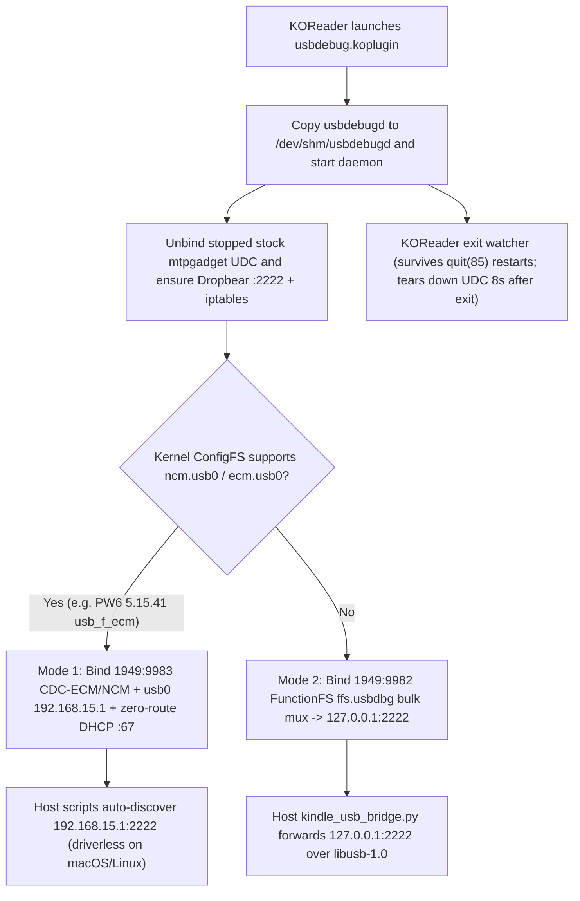

# usbdebug.koplugin

[](https://github.com/anyin233/usbdebug.koplugin/actions/workflows/release.yml)
[](LICENSE)

**Zero-exit USB SSH debug bridge for jailbroken Kindles running KOReader** — plug in a USB cable and immediately run shell commands, read `crash.log`, capture `/dev/fb0` E-Ink screenshots, inject touch gestures, render widgets offscreen, and hot-deploy `.koplugin` bundles **without ever exiting KOReader or needing Wi-Fi**.

Works on both **modern MTP-era Kindles** (Kindle Paperwhite 12th Gen / PW6 `bellatrix4`, Scribe, Colorsoft, FW `5.16`–`5.19.5+`, kernel `5.15.41-lab126`) and legacy Kindles, with macOS & Linux hosts.

> **Why this exists**: When KOReader starts on a jailbroken Kindle, `koreader.sh` stops `volumd`, leaving the USB Device Controller (`UDC`) unbound (charging only). Worse, campus/corporate Wi-Fi networks often enable AP isolation (blocking Wi-Fi SSH) or you may want to keep Airplane Mode on. `usbdebug.koplugin` takes over Linux ConfigFS cleanly while KOReader runs and releases the USB controller automatically when KOReader exits so stock MTP continues working.

---

## Quick Start (3 Steps / 3 步快速开始)

### 1. Host Prerequisites (macOS / Linux)

**macOS (Homebrew):**
```bash
brew install libmtp libusb sshpass
```

**Debian / Ubuntu:**
```bash
sudo apt-get update && sudo apt-get install -y libmtp-dev libusb-1.0-0 sshpass clang
```

### 2. First-Time Install onto Kindle (Once / 仅需一次)

Exit KOReader back to the stock Kindle UI (MTP or USB Mass Storage mode) once, connect your Kindle via USB, and choose **either**:

- **Option A — One-command bootstrap from source (recommended for MTP Kindles like PW6/Scribe/Colorsoft):**
  ```bash
  git clone https://github.com/anyin233/usbdebug.koplugin.git
  cd usbdebug.koplugin
  ./scripts/bootstrap_mtp.sh
  ```
  *(Compiles `usbdebugd` if needed + our fast non-recursive `mtp_tool`, pauses `ptpcamerad` on macOS, and uploads `usbdebug.koplugin` directly to `/koreader/plugins/usbdebug.koplugin` in ~1 second. If a legacy USB Mass Storage Kindle is mounted, it copies directly.)*

- **Option B — Prebuilt Release zip:**
  Download `usbdebug.koplugin.zip` from [GitHub Releases](https://github.com/anyin233/usbdebug.koplugin/releases), extract it, and place the `usbdebug.koplugin/` folder into `/mnt/us/koreader/plugins/usbdebug.koplugin` (via OpenMTP, Android File Transfer, or USB drive).

Now **open KOReader on your Kindle**. You will not need to exit KOReader for debugging again.

### 3. Debug Immediately over USB (No `KINDLE_HOST` Needed!)

Once KOReader is open, all CLI tools in [`skills/kindle-koreader-usbdebug/scripts/`](skills/kindle-koreader-usbdebug/scripts/) auto-discover your Kindle over USB:

```bash
# 1. Probe USB debug mode (CDC-ECM/NCM 1949:9983 or FunctionFS 1949:9982)
python3 -B skills/kindle-koreader-usbdebug/scripts/kindle_usb_bridge.py probe

# 2. Read logs & run remote commands
skills/kindle-koreader-usbdebug/scripts/kindle_ssh.sh exec "uname -a; cat /var/tmp/usbdebugd.status; tail -n 30 /mnt/us/koreader/crash.log"

# 3. Capture real E-Ink /dev/fb0 screenshot & find UI coordinates
python3 -B skills/kindle-koreader-usbdebug/scripts/kindle_screenshot.py capture /tmp/kindle.png
python3 -B skills/kindle-koreader-usbdebug/scripts/kindle_screenshot.py lines /tmp/kindle.png

# 4. Inject Multi-Touch Type B tap / hold / swipe
skills/kindle-koreader-usbdebug/scripts/kindle_touch.sh tap 636 30
skills/kindle-koreader-usbdebug/scripts/kindle_touch.sh swipe 600 1200 600 400

# 5. Hot-deploy a plugin without AppleDouble (._*) litter
skills/kindle-koreader-usbdebug/scripts/kindle_ssh.sh deploy ./my.koplugin /mnt/us/koreader/plugins/my.koplugin

# 6. Render a KOReader widget offscreen without disturbing /dev/fb0
skills/kindle-koreader-usbdebug/scripts/kindle_offscreen_render.sh my_widget.lua /tmp/preview.png
```

---

## 快速上手（中文指南）

1. **宿主机安装依赖**：
   - macOS：`brew install libmtp libusb sshpass`
   - Linux (Ubuntu/Debian)：`sudo apt-get install -y libmtp-dev libusb-1.0-0 sshpass clang`
2. **首次部署插件到 Kindle（仅这一次需要退出 KOReader 进入 MTP 模式）**：
   ```bash
   git clone https://github.com/anyin233/usbdebug.koplugin.git
   cd usbdebug.koplugin
   ./scripts/bootstrap_mtp.sh
   ```
   脚本会自动编译并检测传统 U盘模式或现代 MTP 设备（绕过 macOS `ptpcamerad` 抢锁，1 秒内将 `usbdebug.koplugin` 写入 `/koreader/plugins/usbdebug.koplugin`）。
3. **打开 KOReader 开始免退出调试**：
   - 无需配置 Wi-Fi，也无需设置 `KINDLE_HOST`。
   - 插件启动后会自动拉起原生免驱 USB 网卡（`1949:9983`，`192.168.15.1:2222`）或自动回退到 FunctionFS 通道（`1949:9982`）。
   - 直接运行上方第 3 步的任意命令即可 **读日志、实时截屏、模拟触控、离屏渲染与热部署文件**。
   - 当你在 Kindle 上退出 KOReader 时，`usbdebugd` 会在 8 秒后自动解绑 USB 控制器并释放端口，原生 MTP 传书功能不受影响。

---

## Companion AI Agent Skill (配套 Agent Skill)

This repository ships a ready-to-use Agent Skill in [`skills/kindle-koreader-usbdebug/`](skills/kindle-koreader-usbdebug/) so coding agents (Antigravity, Claude Code, Codex, etc.) can autonomously inspect your Kindle screen, tap UI elements, read `crash.log`, render widgets offscreen, and deploy plugins over USB.

### Install the Skill

- **Using Skills CLI (`npx`):**
  ```bash
  npx skills add anyin233/usbdebug.koplugin
  ```
- **Google Antigravity** (workspace or global):
  ```bash
  # Project-local
  cp -r skills/kindle-koreader-usbdebug /path/to/your-project/.agents/skills/
  # Or global
  cp -r skills/kindle-koreader-usbdebug ~/.gemini/config/skills/
  ```
- **Claude Code:**
  ```bash
  cp -r skills/kindle-koreader-usbdebug ~/.claude/skills/
  ```
- **Codex:**
  ```bash
  cp -r skills/kindle-koreader-usbdebug ~/.codex/skills/
  ```

---

## How It Works



### Key Engineering Details

- **Driverless on modern macOS & Linux**: Mode 1 uses **CDC-ECM** (`usb_f_ecm.ko`) / **CDC-NCM**, natively handled by macOS `AppleUserECM` / `AppleUSBNCM` and Linux `cdc_ether` / `cdc_ncm` — no deprecated RNDIS kexts (`HoRNDIS`) or SIP disabling required.
- **Zero route/DNS hijacking**: The embedded Go DHCPv4 server assigns `192.168.15.10/24` and intentionally omits DHCP Option 3 (Router) and Option 6 (DNS), with a directed subnet broadcast fallback (`192.168.15.255`) so DHCP works even when Kindle Wi-Fi is off in Airplane Mode.
- **Zero-ZLP FunctionFS fallback**: When Ethernet gadget modules are unavailable, Mode 2 uses FunctionFS (`usb_f_fs.ko`, present on all MTP Kindles) with 12-byte `KDBG` framing and automatic 1-byte padding on multiples of 64 bytes so USB Bulk transfers never stall on 64 B / 512 B packet boundaries.
- **Tight `/var` tmpfs safe**: Stages the daemon binary into `/dev/shm/usbdebugd` (478 MB tmpfs on PW6) instead of `/var/tmp` (64 MB tmpfs, often >95% full).
- **KOReader `quit(85)` restart persistence**: `usbdebugd` holds a single-instance PID lock and waits for 4 consecutive 2-second misses (8 seconds) of `reader.lua` / `koreader.sh` before tearing down ConfigFS, so plugin reload restarts never drop your SSH session.

---

## Building From Source

```bash
# Run Go tests
go vet ./... && go test -v ./...

# Cross-compile static binaries for armv6, armv7, arm64
./scripts/build.sh

# Run host USB bridge self-tests (struct ABI, KDBG boundary padding, mux loopback)
python3 -B skills/kindle-koreader-usbdebug/scripts/kindle_usb_bridge.py selftest
```

## License

[MIT](LICENSE)
